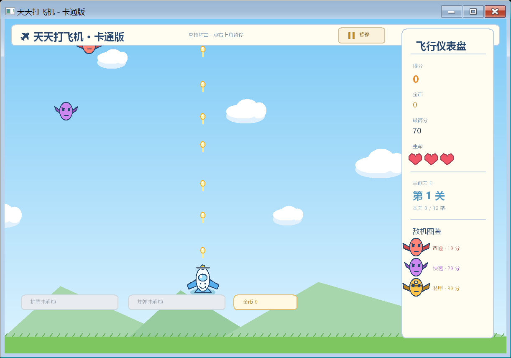
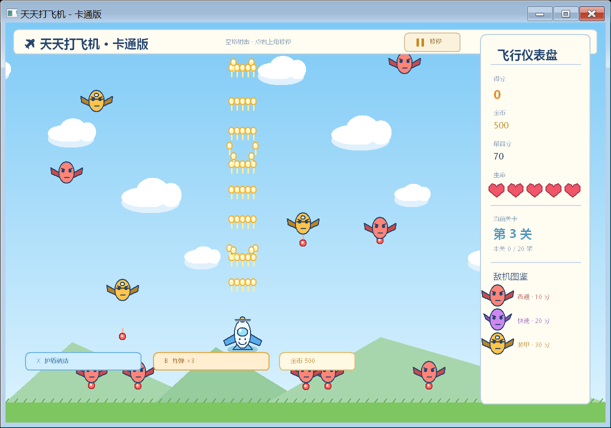
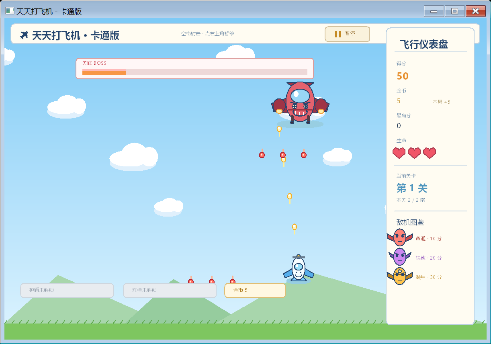
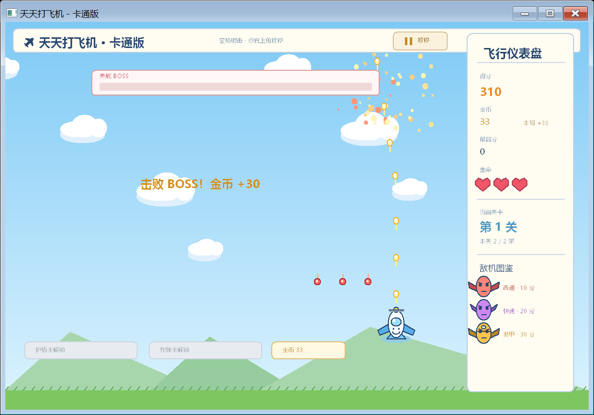
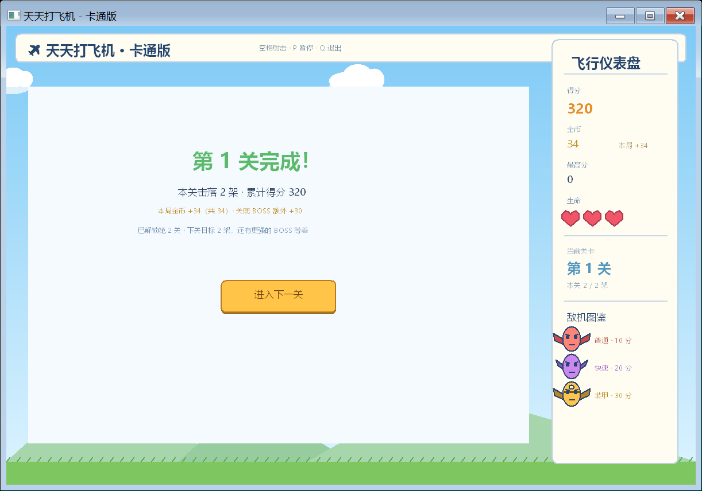

# 天天打飞机

纯 C 语言写的卡通打飞机小游戏，包含两个版本：

| 版本 | 源文件 | 运行方式 | 说明 |
| --- | --- | --- | --- |
| 卡通窗口版 | `plane_shooter_gui.c` | 双击 exe，Win32 窗口 | 1200×800 画布，GDI 绘制，推荐 |
| 控制台版 | `plane_shooter.c` | 命令行/终端 | 字符画界面，无依赖 |

两个版本功能完全一致，均**不依赖任何第三方库**，只用 Windows 自带 API。

## 玩法

- 击落敌机得分并掉落金币，金币可以永久升级技能
- 敌机飞走不会掉血，**只有被敌机撞到、或被敌方子弹打中才会掉生命**
- 打满本关目标敌机数后，会从上方压下一架**关底 BOSS**，必须把它打爆才算通关
- 击败 BOSS 有大量金币奖励（约为小敌机的 10 倍），并额外加分

### 操作

| 按键 | 作用 |
| --- | --- |
| `A` / `D`、`←` / `→` | 左右移动 |
| `W` / `S`、`↑` / `↓` | 上下移动 |
| `空格` | 射击（可长按） |
| `P` / `Esc` | 暂停 / 继续（也可点右上角按钮） |
| `X` | 释放护盾 |
| `B` | 使用炸弹（清屏） |
| `U` | 技能升级界面 |
| `R` | 重新选关 |
| `Q` | 退出 |

### 技能系统（永久生效，存档保存）

| 技能 | 效果 | 价格（金币） |
| --- | --- | --- |
| 火力 | 1 发 → 2 → 3 向散射 → 射速提升 → 4 发 → 5 发 | 20 / 35 / 55 / 80 / 110 |
| 侧翼副炮 | 自动向两侧斜射，最高 3 级 | 25 / 45 / 70 |
| 护盾 | 按 X 短时无敌，持续 3.3 / 4.1 / 4.9 秒 | 30 / 50 / 70 |
| 生命上限 | 3 → 4 → 5 颗心 | 45 / 80 |
| 炸弹 | 每关免费 1 / 2 / 3 次清屏 | 35 / 60 / 90 |

## 关卡

- 第 1 关目标 12 架敌机，之后每关 +4 架
- 关卡越高：敌机下落更快、刷新更密、装甲敌机比例更高、开火更频繁，第 2 关起还会双机齐飞
- 打完一关才解锁下一关，已解锁关卡可在开始界面用 ←/→ 选择

## 编译

### 方式一：TinyCC（体积小，秒编译）

```bat
build_plane_gui.bat   :: 编译卡通窗口版 -> 天天打飞机.exe
build_plane.bat       :: 编译控制台版   -> plane_shooter.exe
```

脚本默认查找 `_t\tools\tcc\tcc\tcc.exe`，找不到会退回系统的 `gcc`。

手动编译：

```bat
tcc plane_shooter_gui.c -o "天天打飞机.exe" -luser32 -lgdi32 -lmsvcrt
tcc plane_shooter.c     -o plane_shooter.exe -luser32
```

### 方式二：MSVC / MinGW

```bat
gcc plane_shooter_gui.c -o tiantian.exe -luser32 -lgdi32 -lmsvcrt -mwindows
```

## 存档文件

游戏会在 exe 同目录生成三个文本存档，删除即恢复初始状态：

- `plane_shooter_best.txt` — 最高分
- `plane_shooter_progress.txt` — 已解锁关卡
- `plane_shooter_coins.txt` — 金币与技能等级（第一行金币，第二行五个技能等级）

## 实现要点

- 单文件 Win32 程序，双缓冲绘制（`CreateCompatibleDC` + `BitBlt`）避免闪烁
- 固定 1200×800 画布 1:1 绘制，按显示器宽度决定窗口大小，不做拉伸（高 DPI 下 StretchBlt 会裁掉右侧内容）
- 中文窗口标题需 `MultiByteToWideChar(CP_UTF8)` 转宽字符后 `SetWindowTextW`，否则标题栏乱码
- 游戏循环基于 `PeekMessage` + `GetTickCount` 计算 `dt`，暂停时直接跳过更新使画面完全冻结

> 踩坑记录：TinyCC 下把 `f(g.x + a, g.y - b)` 这种带运算的表达式直接当 `float` 实参传递会算错（第二个参数被算成 0），必须先落到局部变量再传。

## 截图

| 开始界面 | 战斗画面 |
| --- | --- |
|  |  |

| 满级弹幕 | BOSS 登场 |
| --- | --- |
|  |  |

| 击败 BOSS | 通关结算 |
| --- | --- |
|  |  |
